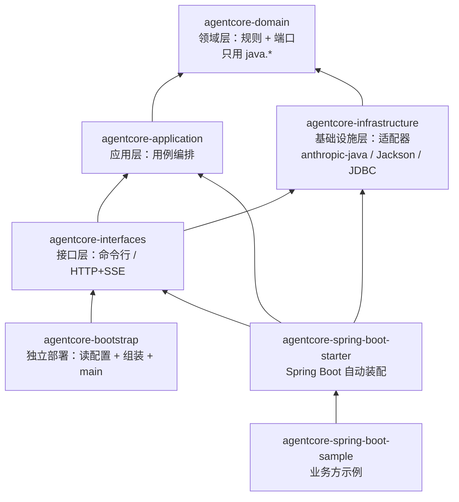
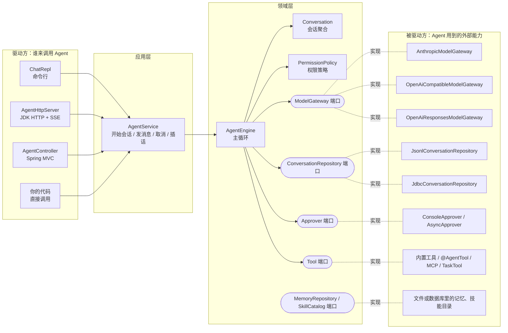
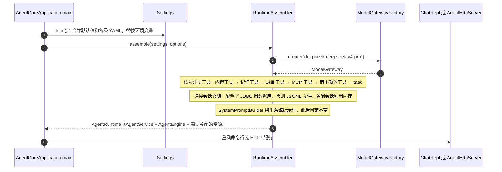
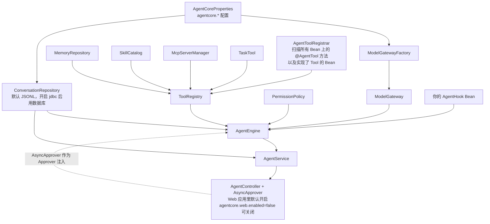
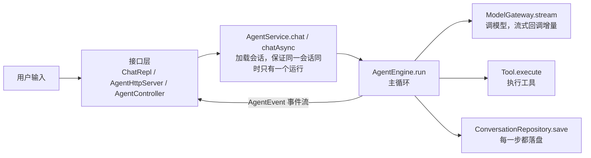

# 01 架构总览

一句话：**领域层定义"Agent 怎么工作"的规则和它需要的接口（端口），基础设施层用具体技术实现这些接口，最外层负责读配置、把零件拼起来、对外提供命令行 / HTTP / Spring Boot 入口。**

## 1. 七个 Maven 模块和依赖方向

箭头表示"依赖于"。所有箭头最终都指向 `domain`，`domain` 自己不依赖任何东西。

几条硬规则：

- **领域层只 import `java.*`**。不碰 Spring、Jackson、JDBC、HTTP。所以核心逻辑可以单独测试，换框架也不用动它。
- **应用层也不依赖框架**，只依赖领域层。
- **基础设施层不依赖应用层**（只在测试里用到）。它只做一件事：实现领域层定义的接口。
- Spring 只出现在 starter 和 sample 里。独立部署版（`bin/agentcore`）完全不需要 Spring。

这些规则由 Maven 模块强制：如果领域层的代码 import 了 Jackson，编译直接失败。

## 2. 端口与适配器（六边形架构）

领域层在中间，它通过"端口"（接口）声明自己需要什么能力；外面一圈是"适配器"，用具体技术实现这些端口。

这样分的好处：

| 想做的事 | 需要改哪里 | 领域层要不要动 |
|---|---|---|
| 接一个新模型厂商 | 在 `infrastructure/llm` 加一个 `ModelGateway` 实现 | 不用 |
| 会话改存到 MongoDB | 加一个 `ConversationRepository` 实现 | 不用 |
| 审批改成发飞书卡片 | 实现 `Approver`，或给 `AsyncApprover` 接一个通道 | 不用 |
| 加一个业务工具 | 写一个 `@AgentTool` 方法或实现 `Tool` | 不用 |
| 改 Agent 的循环规则 | `AgentEngine` | 要，这正是领域层负责的事 |

## 3. 领域层的包

| 包 | 职责 | 核心类型 |
|---|---|---|
| `domain.agent` | Agent 主循环和它对外发出的事件 | `AgentEngine`、`AgentEvent`、`AgentHook`、`RunControl`、`RunResult` |
| `domain.conversation` | 会话聚合、消息、内容块、领域事件 | `Conversation`、`Message`、`ContentBlock` 的各种实现、`event/*` |
| `domain.model` | 和大模型对话的端口及请求、响应 | `ModelGateway`、`ModelRequest`、`ModelResponse`、`StopReason` |
| `domain.tool` | 工具的定义、注册、参数校验 | `Tool`、`FunctionTool`、`ToolRegistry`、`SchemaValidator` |
| `domain.permission` | 工具调用的权限判定和审批端口 | `PermissionPolicy`、`PermissionRule`、`Approver` |
| `domain.context` | 上下文长度估算与压缩 | `ConversationCompactor`、`TokenEstimator` |
| `domain.memory` / `domain.skill` | 长期记忆、技能的端口 | `MemoryRepository`、`SkillCatalog` |
| `domain.shared` | 通用基础类 | `AggregateRoot`、`DomainEvent`、`CancellationToken` |

## 4. 启动时怎么组装

### 独立部署版（`bin/agentcore`）

对应代码：`agentcore-bootstrap/src/main/java/com/agentcore/bootstrap/RuntimeAssembler.java` 的 `assemble` 方法，里面的注释按上面的顺序分段。

### Spring Boot 版

同样的零件，改由 Spring 的 Bean 来组装。每个 Bean 都带 `@ConditionalOnMissingBean`，你在自己的应用里定义同类型 Bean 就能替换掉默认的。

对应代码：`agentcore-spring-boot-starter/.../AgentCoreAutoConfiguration.java`、`jdbc/AgentCoreJdbcAutoConfiguration.java`、`web/AgentCoreWebAutoConfiguration.java`。

## 5. 一次请求穿过哪些类（概览）

主循环内部的细节见 [02 Agent 主循环](02-agent-loop.md)。

## 6. 几个贯穿全局的设计决策

1. **历史只追加，原样回放。** 会话里的消息只会往后加，不会就地修改。发给模型的内容在会话开始后保持稳定，模型厂商的提示缓存（prompt cache）才能持续命中，省钱也更快。唯一的"整体替换"是上下文压缩，它生成一段新的合法对话。
2. **历史永远合法。** 模型发起的每个工具调用都必须有对应的结果，否则下一次请求会被厂商拒绝。`Conversation` 在每个修改方法里检查这条规则；进程崩溃、取消、出错时会自动补上错误结果。详见 [03](03-conversation.md)。
3. **事件就是存储格式。** `Conversation` 的每次变化都产生一条领域事件，仓储只负责把事件追加写入。读取时按顺序重放事件就能还原会话。详见 [06](06-persistence.md)。
4. **引擎无状态，可并发。** 一个 `AgentEngine` 可以同时服务很多会话。每次运行的状态放在内部类 `Run` 里，工具的会话级状态按会话 ID 隔离。
5. **一切过程都是事件。** 引擎不直接打印任何东西，只发出 `AgentEvent`。命令行把事件渲染成彩色文本，HTTP 把它变成 SSE，测试把它收集起来断言。
