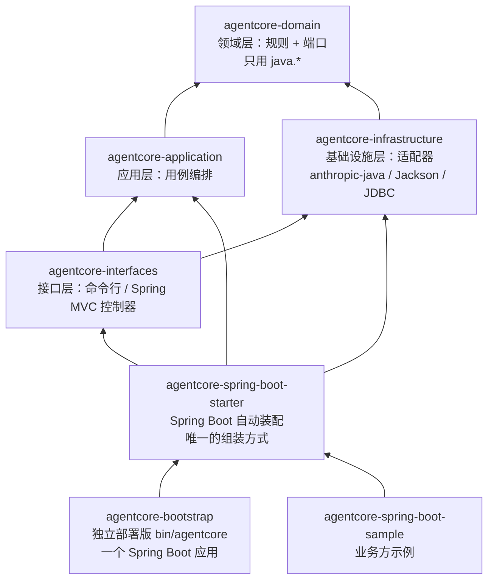
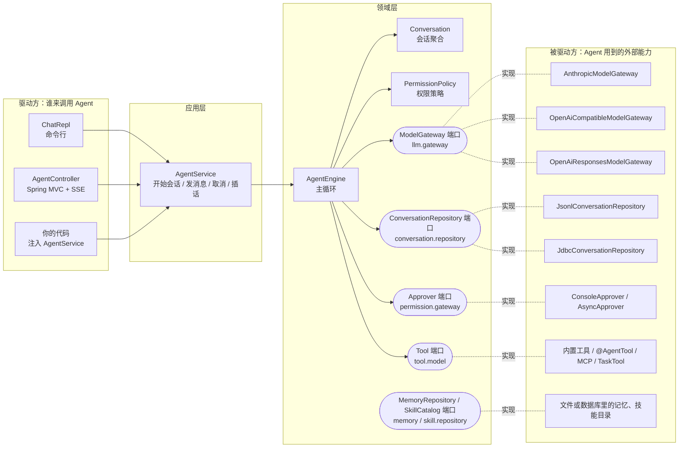
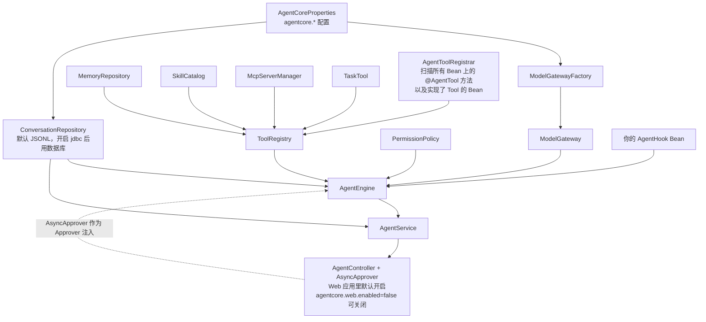
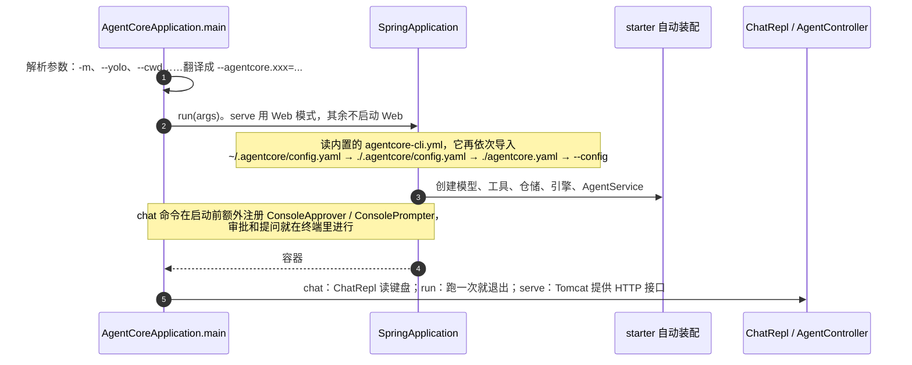
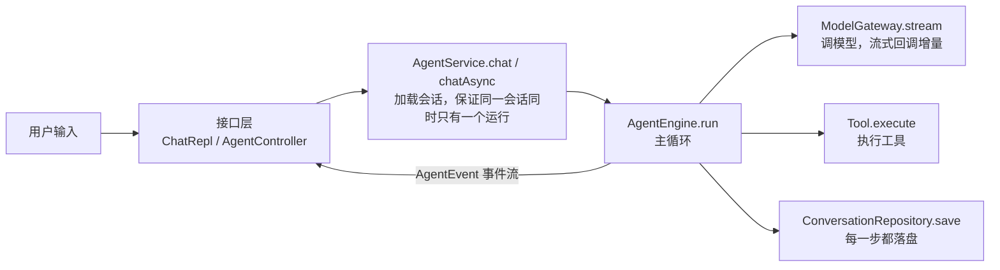

# 01 架构总览

一句话：**领域层定义"Agent 怎么工作"的规则和它需要的接口（端口），基础设施层用具体技术实现这些接口，最外层用 Spring Boot 读配置、把零件拼起来、对外提供命令行和 HTTP 入口。**

## 1. 七个 Maven 模块和依赖方向

箭头表示"依赖于"。所有箭头最终都指向 `domain`，`domain` 自己不依赖任何东西。



规则：

- **硬性规则只有一条：领域层只 import `java.*`**。不碰 Spring、Jackson、JDBC、HTTP。所以核心逻辑可以单独测试，换框架也不用动它。这条由 Maven 模块强制：领域层的代码 import 了 Jackson 或 Spring，编译直接失败。
- **外层统一用 Spring Boot**：组装只有 starter 的自动装配一套，配置只有 `agentcore.*` 一套，HTTP 接口是 Spring MVC 注解控制器。独立部署版 `bin/agentcore` 本身也是 Spring Boot 应用，和嵌入业务系统时走同一条路径。后续写插件、做配置预热都可以直接用 Spring 的机制。
- 应用层和基础设施层目前没有用到 Spring（不是硬性要求，只是还不需要），所以也能不借助容器、手动 `new` 出来用，测试就是这么写的。
- **基础设施层不依赖应用层**（只在测试里用到）。它只做一件事：实现领域层定义的接口。

## 2. 端口与适配器（六边形架构）

领域层在中间，它通过"端口"（接口）声明自己需要什么能力；外面一圈是"适配器"，用具体技术实现这些端口。



这样分的好处：

| 想做的事 | 需要改哪里 | 领域层要不要动 |
|---|---|---|
| 接一个新模型厂商 | 在 `infrastructure/llm` 加一个 `ModelGateway` 实现 | 不用 |
| 会话改存到 MongoDB | 加一个 `ConversationRepository` 实现 | 不用 |
| 审批改成发飞书卡片 | 实现 `Approver`，或给 `AsyncApprover` 接一个通道 | 不用 |
| 加一个业务工具 | 写一个 `@AgentTool` 方法或实现 `Tool` | 不用 |
| 改 Agent 的循环规则 | `AgentEngine` | 要，这正是领域层负责的事 |

## 3. 领域层的包

领域层先按业务模块分包，每个模块里再按 DDD 构件类型分子包。新增代码时按"它是什么"放进对应的子包，以后扩展不用再调整结构：

| 子包 | 放什么 | 例子 |
|---|---|---|
| `model` | 聚合根、实体、值对象 | `conversation.model.Conversation`、`agent.model.RunResult` |
| `event` | 事件 | `conversation.event.MessageAppended`、`agent.event.AgentEvent` |
| `service` | 领域服务：无状态、跨多个对象的业务规则。默认直接写类，只有业务方会想换成自己规则的才抽接口 | `agent.service.AgentEngine`（类）、`permission.service.PermissionPolicy`（接口 + 默认实现） |
| `repository` | 存取数据的端口，基础设施层实现 | `conversation.repository.ConversationRepository` |
| `gateway` | 调用外部系统或人的端口，基础设施层或接口层实现 | `llm.gateway.ModelGateway`、`permission.gateway.Approver` |
| `exception` | 本模块的异常 | `llm.exception.ContextOverflowException` |
| 其他 | 按职责命名 | `conversation.message`（消息这一组值对象）、`tool.schema`、`agent.hook`、`agent.interceptor`、`shared.cancel` |

完整结构（`com.agentcore.domain` 下）：

```text
agent            Agent 运行
├── service      AgentEngine（主循环 ①～⑩）· ToolExecutor（工具分批并行）
├── interceptor  ToolInterceptor · ToolInvocation · 参数校验 / 权限审批 / 钩子 / 截断 四个内置拦截器
├── model        AgentDefinition · EngineSettings · RunControl · RunResult
├── event        AgentEvent · AgentEventListener
└── hook         AgentHook · HookDecision
conversation     会话
├── model        Conversation（聚合根）· ConversationId · ConversationSummary · TokenUsage
├── message      Message · Role · ProviderPayload · ContentBlock 及五种内容块
├── event        ConversationStarted · MessageAppended · ConversationCompacted · UsageRecorded · MetadataUpdated
└── repository   ConversationRepository
context          上下文管理
├── model        CompactionSettings
└── service      ConversationCompactor · TokenEstimator
llm              大模型
├── model        ModelRequest · ModelResponse · StopReason · ToolSpec
├── gateway      ModelGateway · ModelStreamListener · RetryingModelGateway（重试装饰器）
└── exception    ModelException · ContextOverflowException · MalformedOutputException
tool             工具
├── model        Tool · FunctionTool · ToolContext · ToolOutput · ToolRegistry · PermissionLevel
├── schema       Schemas · SchemaValidator
├── gateway      UserPrompter
└── exception    ToolException
permission       权限与审批
├── model        Approval · Decision · PermissionMode · PermissionRequest · PermissionRule
├── service      PermissionPolicy（接口）· RulePermissionPolicy（默认实现，基于配置规则）
└── gateway      Approver
memory           长期记忆：model（MemoryEntry · MemoryType）· repository（MemoryRepository）
skill            技能：model（Skill）· repository（SkillCatalog）
shared           共用：model（AggregateRoot · DomainEvent）· exception · cancel（CancellationToken）· util
```

`ContentBlock` 是 sealed 接口，Java 要求它的五种实现和它放在同一个包里，所以都在 `conversation.message`。

## 4. 启动时怎么组装

不管是独立部署版还是嵌入业务系统，组装都只有一套：`agentcore-spring-boot-starter` 的自动装配。每个 Bean 都带 `@ConditionalOnMissingBean`，在自己的应用里定义同类型 Bean 就能替换默认实现。



对应代码：`agentcore-spring-boot-starter/.../AgentCoreAutoConfiguration.java`、`jdbc/AgentCoreJdbcAutoConfiguration.java`、`web/AgentCoreWebAutoConfiguration.java`。

### 独立部署版（`bin/agentcore`）怎么启动

`AgentCoreApplication` 是一个 `@SpringBootApplication`，它自己不组装任何东西，只是把命令行参数翻译成 Spring 配置，然后按命令启动容器：



对应代码：`agentcore-bootstrap/src/main/java/com/agentcore/bootstrap/` 下的 `AgentCoreApplication`（启动和各命令）、`CliArgs`（参数解析与翻译）、`OptionalDataSource`（没配数据库时跳过数据源），以及 `src/main/resources/` 下的 `agentcore-cli.yml`（配置导入顺序）和 `agentcore-template.yaml`（`init` 生成的模板）。

## 5. 一次请求穿过哪些类（概览）



主循环内部的细节见 [02 Agent 主循环](02-agent-loop.md)。

## 6. 几个贯穿全局的设计决策

1. **历史只追加，原样回放。** 会话里的消息只会往后加，不会就地修改。发给模型的内容在会话开始后保持稳定，模型厂商的提示缓存（prompt cache）才能持续命中，省钱也更快。唯一的"整体替换"是上下文压缩，它生成一段新的合法对话。
2. **历史永远合法。** 模型发起的每个工具调用都必须有对应的结果，否则下一次请求会被厂商拒绝。`Conversation` 在每个修改方法里检查这条规则；进程崩溃、取消、出错时会自动补上错误结果。详见 [03](03-conversation.md)。
3. **事件就是存储格式。** `Conversation` 的每次变化都产生一条领域事件，仓储只负责把事件追加写入。读取时按顺序重放事件就能还原会话。详见 [06](06-persistence.md)。
4. **引擎无状态，可并发。** 一个 `AgentEngine` 可以同时服务很多会话。每次运行的状态放在内部类 `Run` 里，工具的会话级状态按会话 ID 隔离。
5. **一切过程都是事件。** 引擎不直接打印任何东西，只发出 `AgentEvent`。命令行把事件渲染成彩色文本，HTTP 把它变成 SSE，测试把它收集起来断言。
