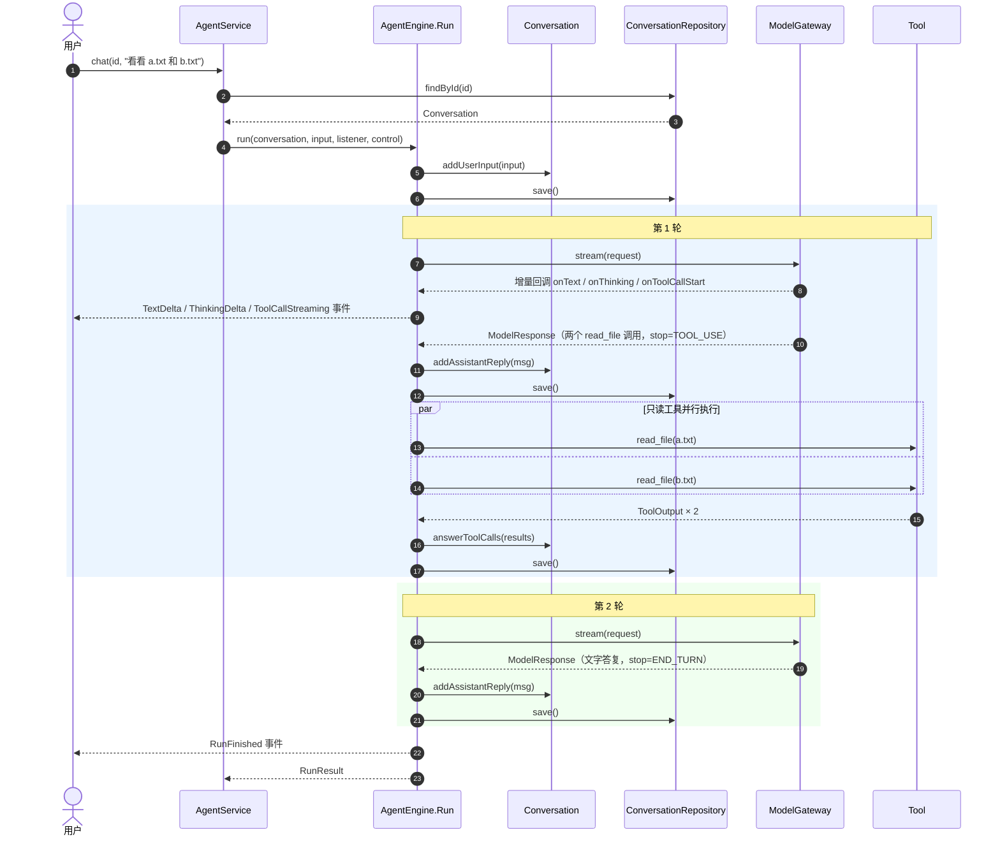
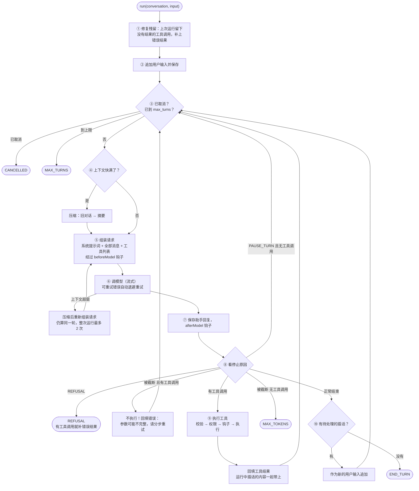
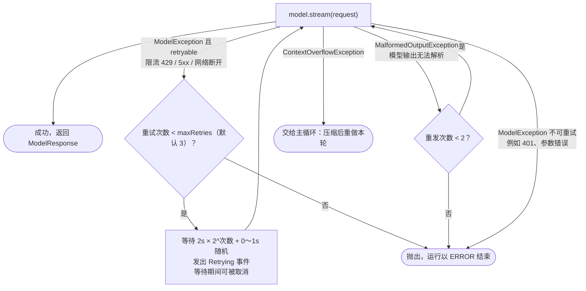
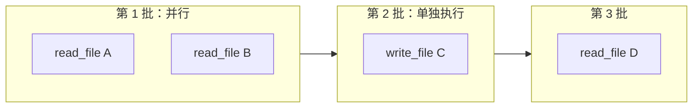
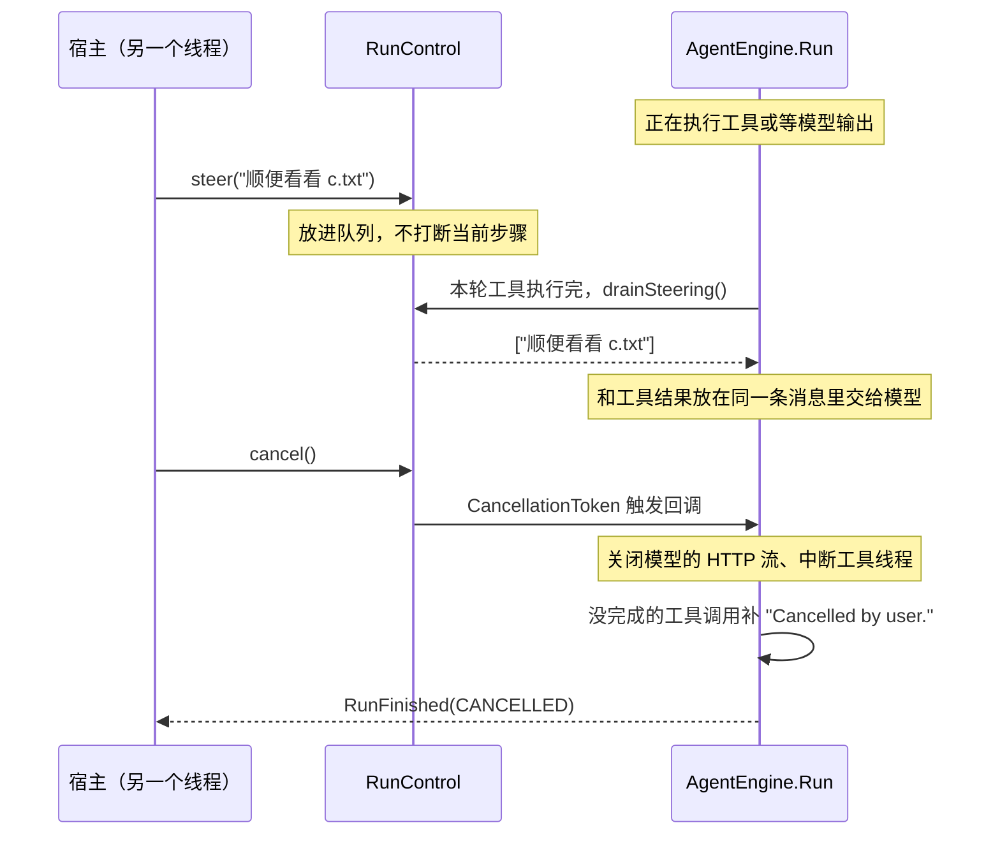

# 02 Agent 主循环

Agent 的核心只有一个循环：**把对话发给模型 → 模型要调用工具就执行工具，把结果加进对话 → 再发给模型 → ……直到模型给出最终答复。**
这个循环在 `agentcore-domain/src/main/java/com/agentcore/domain/agent/service/AgentEngine.java` 的内部类 `Run` 里。

## 1. 一次运行的时序

以"用户让 Agent 查两个文件"为例：模型第一轮要求读两个文件，第二轮给出答案。



注意每一步之后都会 `save()`：进程随时崩溃，已经发生的事都已经落盘，重启后可以接着跑。

## 2. 主循环流程图

图里的 ①～⑩ 和 `AgentEngine.Run` 里各方法上的编号一一对应：`execute` 是总流程，`start` 是 ①②，`loop` 是 ③④ 并把每一轮串起来，`callModel` 是 ⑤⑥，`saveReply` 是 ⑦，`decideNext` 是 ⑧～⑩。



不管走到哪个出口，最后都会发出 `RunFinished` 事件并返回 `RunResult`。运行中抛出的异常也被接住：

| 异常 | 结果 | 收尾 |
|---|---|---|
| `CancelledException`（用户取消） | `CANCELLED` | 给没结果的工具调用补上 "Cancelled" 结果 |
| 其他 `RuntimeException`（例如不可重试的模型错误） | `ERROR`，错误信息放在 `RunResult.error` | 同样补结果，保证历史合法 |

## 3. 停止原因

`StopReason` 一部分来自模型，一部分是引擎自己产生的。

| 值 | 谁产生 | 什么时候 | 引擎怎么处理 |
|---|---|---|---|
| `END_TURN` | 模型 | 正常说完了 | 结束运行（除非有插话） |
| `TOOL_USE` | 模型 | 要调用工具 | 执行工具，进入下一轮 |
| `MAX_TOKENS` | 模型 | 单次输出到了上限 | 有工具调用：不执行，回填错误让模型分步做；没有：结束并提示可能不完整 |
| `PAUSE_TURN` | 模型 | Claude 的服务端工具暂停了 | 原样再发一次，让它继续 |
| `REFUSAL` | 模型 | 安全拒答 | 结束运行 |
| `CONTEXT_OVERFLOW` | 模型 | 生成过程中撑满了上下文窗口 | 有工具调用：不执行、回填错误，下一轮开始前强制压缩；没有：按 `MAX_TOKENS` 结束。（请求一发出去就超窗是另一种情况：适配器抛 `ContextOverflowException`，见第 4 节） |
| `MAX_TURNS` | 引擎 | 轮数达到 `agentcore.agent.max-turns`（默认 100） | 结束 |
| `CANCELLED` | 引擎 | 用户取消 | 结束 |
| `ERROR` | 引擎 | 不可恢复的错误 | 结束 |

## 4. 调模型时的重试

重试由装饰器 `RetryingModelGateway`（`domain/llm/gateway/`）负责：引擎创建时自动把模型包在它里面，把一次模型调用变得"尽量成功"。重试时它通过回调通知引擎，引擎转成 `Retrying` 事件：



适配器负责把各家的错误翻译成这三类异常，见 [05 模型适配](05-model-gateways.md)。

## 5. 工具怎么执行：分批 + 并行

模型一次回复里可能要求调用多个工具，由 `ToolExecutor`（`domain/agent/service/`）执行，规则是：

- **连续的**"可并行"工具（`Tool#concurrencySafe()`，默认等于只读）分成一批，在虚拟线程上并发执行；
- 其余工具单独成批，按顺序执行；
- 同时运行的工具数不超过 `agentcore.agent.max-tool-concurrency`（默认 8）；
- 不管执行顺序如何，**结果按模型调用的顺序**回填。

例子：模型依次调用 `read A`、`read B`、`write C`、`read D`：



`write C` 必须等 A、B 读完再写，`read D` 必须等 C 写完再读，这样读到的永远是正确的状态。

单个工具调用内部还要经过参数校验、权限、审批、钩子等关卡，见 [04 工具、权限、审批与钩子](04-tools-and-permissions.md)。

## 6. 取消与插话

两者都通过 `RunControl` 传给引擎，宿主（命令行、HTTP）在另一个线程里调用。



- **插话**在两个时机交给模型：工具执行完时，和工具结果一起发；或者模型已经说完了，作为一条新的用户消息继续跑。
- **取消**是协作式的：每轮开始、每批工具之间、重试等待中都会检查；正在阻塞的 HTTP 读取会被直接关闭。取消后会话依然合法，可以继续发消息。

## 7. 什么时候压缩上下文

每轮开始前估算当前上下文的 token 数（`AgentEngine#estimateContextTokens`）：

- 上一次模型调用返回了真实用量，就以它为基线，只估算之后新增的消息；
- 没有基线时，按字符数粗估：英文约 4 个字符 1 个 token，中文约 1.2 个字符 1 个 token。

超过 `上下文窗口 × agentcore.context.threshold`（默认 0.75），或超过 `agentcore.context.max-tokens`（设置了的话），就触发压缩。
压缩的过程和"为什么不直接删旧消息"见 [03 会话聚合](03-conversation.md#5-上下文压缩)。

## 8. 对外发出的事件

引擎从不直接打印，所有过程都通过 `AgentEventListener` 发出 `AgentEvent`。命令行、HTTP SSE、`--events` 输出的都是这些事件。

| 事件（JSON 里的 type） | 什么时候发 | 主要字段 |
|---|---|---|
| `run_started` | 运行开始 | 会话 ID、Agent 名、模型 |
| `turn_started` | 每轮开始 | 轮次号 |
| `text_delta` | 模型吐出一段文字 | 文字增量 |
| `thinking_delta` | 模型吐出一段思考 | 思考增量 |
| `tool_call_streaming` | 模型开始写一个工具调用（参数还没写完） | 调用 ID、工具名 |
| `assistant_message` | 一轮模型回复完整结束 | 完整消息、用量、停止原因 |
| `permission_decided` | 需要审批的调用有了结论 | 允许 / 拒绝、原因 |
| `tool_started` | 工具开始执行 | 调用、一行摘要 |
| `tool_progress` | 工具上报进度 | 进度文字 |
| `tool_finished` | 工具执行完（含失败、被拒） | 输出、是否出错、耗时 |
| `compacted` | 完成一次压缩 | 压缩前后 token 数、摘要 |
| `retrying` | 模型调用失败，准备重试 | 第几次、等待毫秒数、错误 |
| `notice` | 提示信息 | 级别（info / warning / error）、内容 |
| `run_finished` | 运行结束 | 停止原因、最终文字、轮数、总用量、错误 |

实际输出的样子（离线假模型）：

```text
$ bin/agentcore run -m mock --no-session --events "你好"
{"type":"run_started","conversation_id":"20261105-013500-40637d","agent":"agentcore","model":"mock:scripted"}
{"type":"turn_started","turn":1}
{"type":"text_delta","text":"(mock) 你好，我是一个离线"}
{"type":"text_delta","text":"假模型。"}
{"type":"assistant_message","message":{...},"usage":{...},"stop_reason":"end_turn"}
{"type":"run_finished","stop_reason":"end_turn","text":"(mock) 你好，我是一个离线假模型。","turns":1,"usage":{...}}
```

## 9. AgentService 在外面加了什么

`AgentEngine` 只管"跑一次"。`agentcore-application/.../AgentService.java` 在它外面加了用例层的规则：

| 方法 | 作用 |
|---|---|
| `startConversation(metadata)` | 新建会话，记下模型、Agent 名、工作目录等元数据 |
| `chat(id, text, listener)` | 同步执行，阻塞到运行结束 |
| `chatAsync(id, input, listener)` | 在虚拟线程上执行，立刻返回 `RunHandle`（可取消、可插话、可等结果），Web 服务用它 |
| `cancel(id)` / `steer(id, text)` | 找到正在运行的任务，转给它的 `RunControl` |
| `compact(id)` | 手动压缩（运行中不允许） |

最重要的一条约束：**同一个会话同一时刻只能有一个运行**。第二个请求会直接报错，而不是排队，否则两个运行会同时往一段历史里写。
