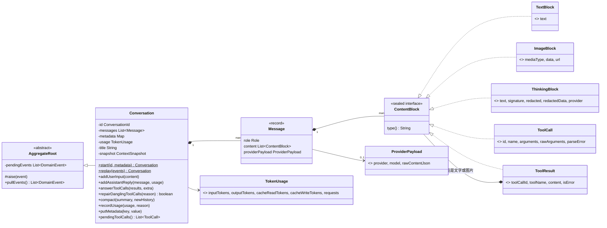
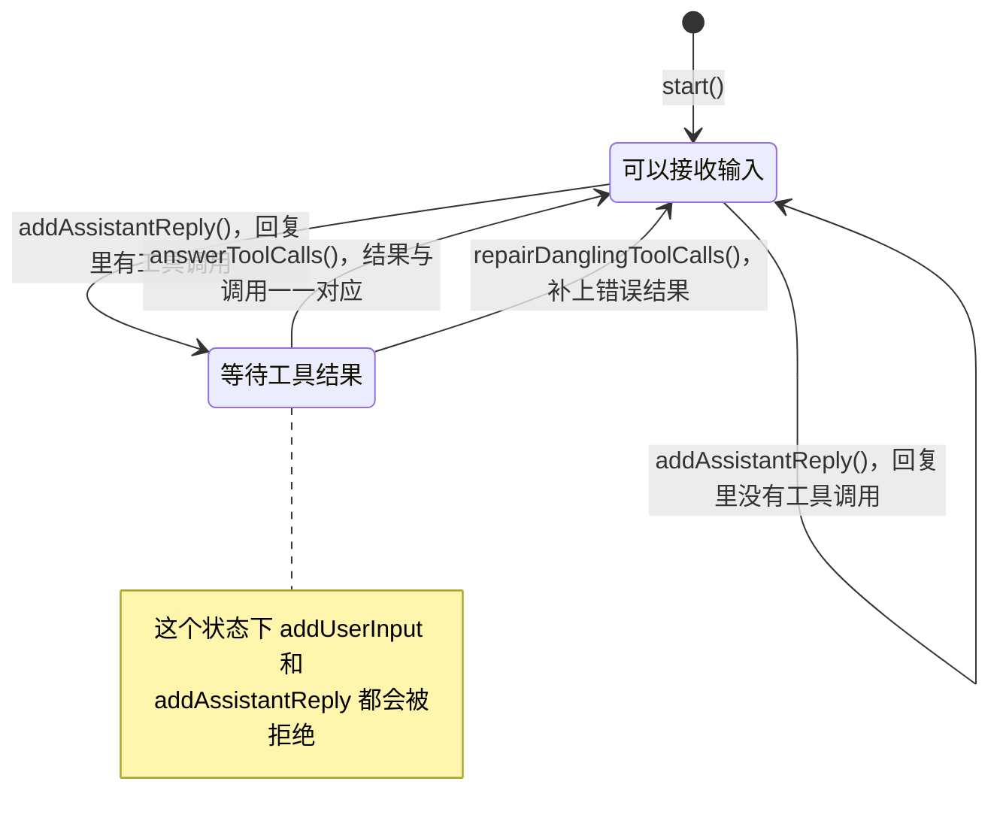
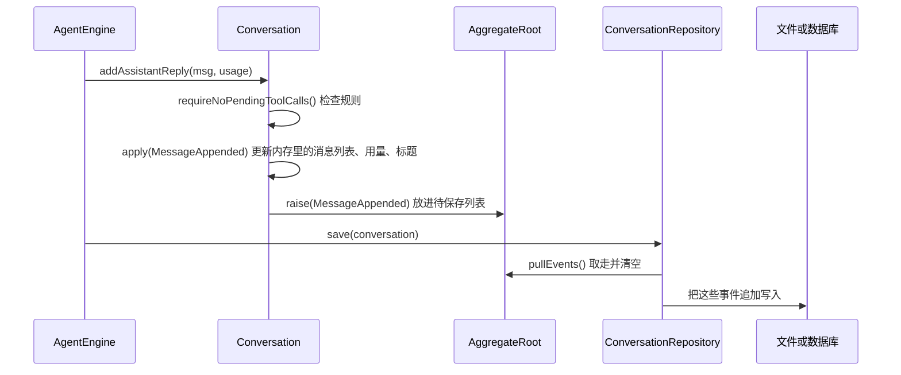
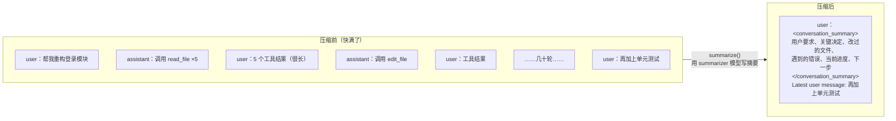

# 03 会话聚合与事件溯源

`Conversation`（`agentcore-domain/.../conversation/model/Conversation.java`）是整个项目里唯一的聚合根，代表一个会话。
它要解决的问题只有一个：**不管发生什么（崩溃、取消、出错、并发），发给模型的历史都必须是合法的。**

## 1. 数据模型



- `Message`、各种 `ContentBlock`、`TokenUsage` 都是不可变的 record（DDD 里的"值对象"），创建后不能改。
- `ContentBlock` 是 `sealed` 接口，只有五种实现，`switch` 时编译器能检查有没有漏掉。

各种内容块能出现在哪种消息里：

| 内容块 | 用户消息 | 助手消息 | 说明 |
|---|---|---|---|
| `TextBlock` | ✓ | ✓ | 普通文字 |
| `ImageBlock` | ✓ | | 图片：base64 数据或 URL |
| `ThinkingBlock` | | ✓ | 模型的思考内容。`provider` 记下是哪家产生的，签名只对同一家有效 |
| `ToolCall` | | ✓ | 模型要求调用工具。参数解析失败时 `parseError` 非空，这个调用不会被执行 |
| `ToolResult` | ✓ | | 工具执行结果，`toolCallId` 对应某个 `ToolCall` |

`ProviderPayload` 是模型厂商返回的原始内容（JSON 字符串）。下次发给**同一家**时原样回放，Claude 的思考签名、OpenAI 的加密推理才不会丢；发给别家时则用上面这些通用内容块重新转换。详见 [05 模型适配](05-model-gateways.md)。

## 2. 核心规则：工具调用必须一一回复

所有模型厂商的 API 都要求：助手消息里发起了工具调用，**紧接着的下一条**必须是包含全部结果的用户消息，ID 一一对应。少一个、多一个、顺序中间插了别的消息，请求都会被拒绝。

合法的历史：

```text
user       "看看 a.txt 和 b.txt"
assistant  [ToolCall id=1 read_file(a.txt), ToolCall id=2 read_file(b.txt)]
user       [ToolResult id=1 "...", ToolResult id=2 "..."]      ← 两个结果都在，ID 对得上
assistant  "a.txt 里是……，b.txt 里是……"
```

不合法的历史（`Conversation` 会直接抛 `DomainException`，根本写不进去）：

```text
assistant  [ToolCall id=1, ToolCall id=2]
user       [ToolResult id=1]                ← 少了 id=2
user       "再帮我看看 c.txt"                ← 工具调用还没回复就追加新输入
```

可以把会话看成一个只有两个状态的状态机：



"等待工具结果"就是 `pendingToolCalls()` 非空：最后一条消息是带工具调用的助手消息。

### 什么时候需要"修复"

进程在工具执行到一半时崩溃，或者用户取消、运行出错，历史会停在"等待工具结果"。`repairDanglingToolCalls(reason)` 给每个没有结果的调用补一个错误结果，让历史重新合法：

| 调用方 | 时机 | 补的内容 |
|---|---|---|
| `AgentEngine` 每次运行开始 | 上次运行异常结束留下的残局 | "Interrupted: the previous run ended before this tool finished." |
| 取消 | `CancelledException` | "Cancelled: ..." |
| 运行出错 | 其他异常 | "Error: the run failed before this tool finished." |
| 模型拒答 | `REFUSAL` 时回复里带了工具调用 | "Not executed: the response was refused." |

模型下一轮看到这些错误结果，自然知道那些操作没做成。

## 3. 事件溯源：变化即事件，事件即存储

`Conversation` 不提供 setter。每个修改方法都按同一个套路走：**检查规则 → 生成一个领域事件 → `apply` 事件改内存状态 → `raise` 事件等待保存**。



读取时反过来：从存储里按顺序读出全部事件，`Conversation.replay(events)` 对每个事件调用同一个 `apply`，就还原出一模一样的会话。

五种领域事件（`conversation.event` 包）：

| 事件 | 由哪个方法产生 | `apply` 时做什么 |
|---|---|---|
| `ConversationStarted` | `start()` | 必须是第一个事件，带 ID 和初始元数据 |
| `MessageAppended` | `addUserInput` / `addAssistantReply` / `answerToolCalls` | 追加消息；助手消息还累计用量、更新上下文快照；第一条用户输入确定标题 |
| `ConversationCompacted` | `compact()` | 用新历史整体替换消息列表 |
| `UsageRecorded` | `recordUsage()` | 累计额外用量（压缩、子 Agent 花的 token） |
| `MetadataUpdated` | `putMetadata()` | 改一个元数据键值 |

为什么这样做：

- **崩溃安全。** 存储只追加不修改，最坏情况是最后一行写了一半，读取时跳过即可。
- **存储实现很简单。** 仓储不需要理解会话的结构，只要能"按顺序追加、按顺序读出"就行。JSONL 文件和数据库表的实现都只有一两百行。
- **天然有审计记录。** 会话经历过的每一次变化都在。

## 4. 几个派生出来的状态

这些都不单独存储，而是在 `apply` 事件时算出来的：

| 状态 | 怎么来的 | 用途 |
|---|---|---|
| `usage` | 所有 `MessageAppended`、`UsageRecorded` 的用量相加 | 显示会话总花费 |
| `title` | 第一条普通用户输入的第一行，最多 80 字，**确定后不再变**（压缩也不影响） | 会话列表 |
| `contextSnapshot` | 最近一次助手回复的"输入 + 输出 token 数"以及当时的消息条数 | 精确估算下一次请求有多大（见 [02](02-agent-loop.md#7-什么时候压缩上下文)） |
| `compactions` | 压缩次数 | 统计 |

## 5. 上下文压缩

对话越来越长，迟早会超过模型的上下文窗口。`ConversationCompactor`（`domain/context/service/`）的做法是：**把旧对话交给模型写一份交接摘要，然后用"摘要 + 最新一条用户输入"开启一段新的对话。**



步骤（`AgentEngine.Run#compact`）：

1. `plan()`：最后一条是普通用户输入就保留它，其余全部拿去总结；最后一条是工具结果就全部总结（工具结果不能脱离它的调用单独存在）。
2. `summarize()`：把要总结的部分渲染成纯文本记录（太长时保留开头 20% 和结尾 80%），让模型按固定的六个部分写交接摘要。可以用 `agentcore.context.summarizer-model` 指定更便宜的模型。
3. `buildCompactedHistory()`：拼出新历史。
4. `conversation.compact(summary, newHistory)`：检查新历史合法（以用户消息开头、结尾没有未回复的工具调用），产生 `ConversationCompacted` 事件。

**为什么不直接删掉最旧的几条消息？**

- 删消息很容易把一个工具调用和它的结果拆开，历史就不合法了。
- 模型厂商的提示缓存按前缀匹配。在中间删改，后面的缓存全部失效；而"摘要后开新对话"之后，新的前缀又能持续命中。
- 新一代 Claude 会校验思考块所在的对话前缀，就地改写历史会让思考块失效甚至报错。摘要后的新对话对所有厂商都是一段干净的合法对话。

压缩失败（比如摘要模型报错）不会让运行失败，只会发一条 warning，下一轮再试。

## 6. 线程安全

`Conversation` 的所有公开方法都是 `synchronized` 的，`messages()` 返回副本。
所以运行中，HTTP 接口可以在另一个线程里安全地读取会话详情；仓储的身份映射也保证同一进程里同一个会话只有一个实例。
