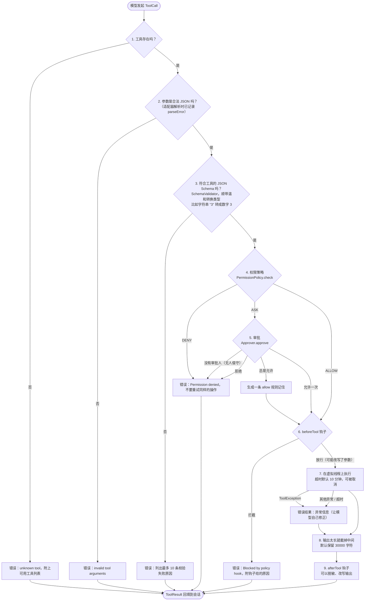
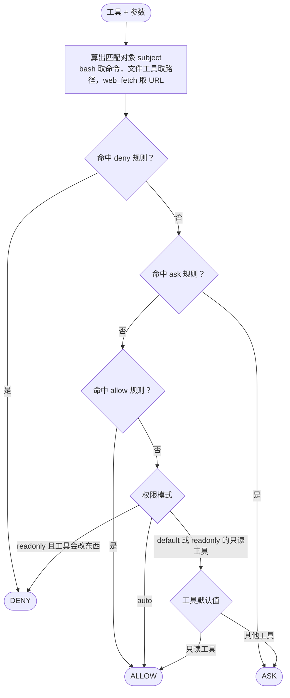
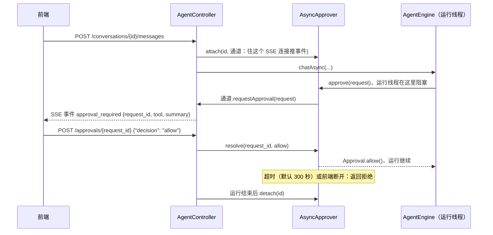
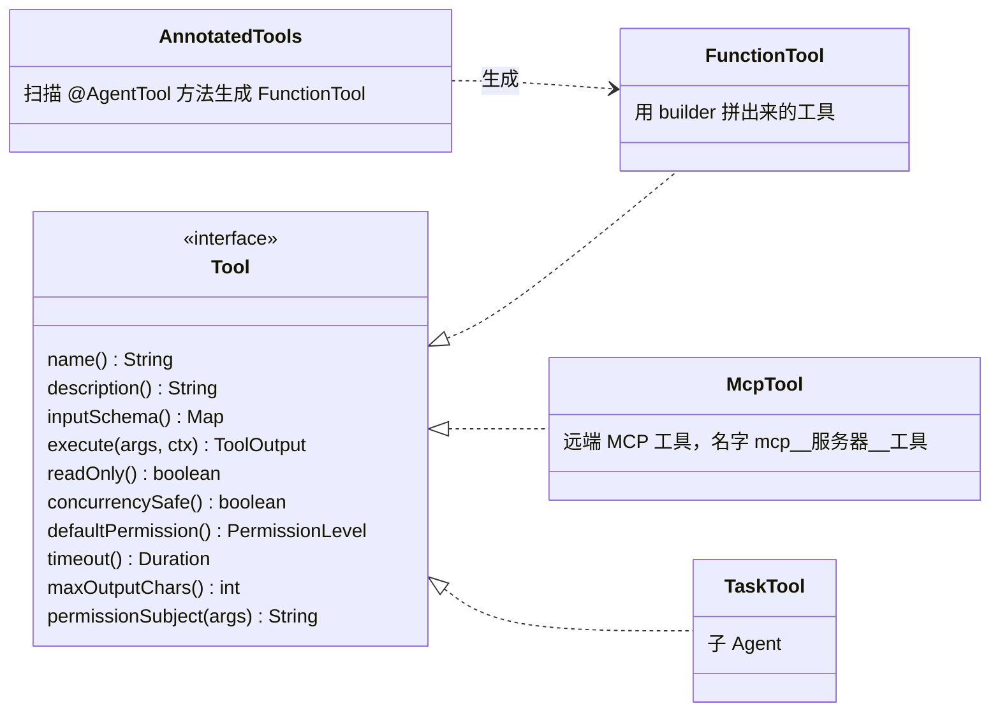
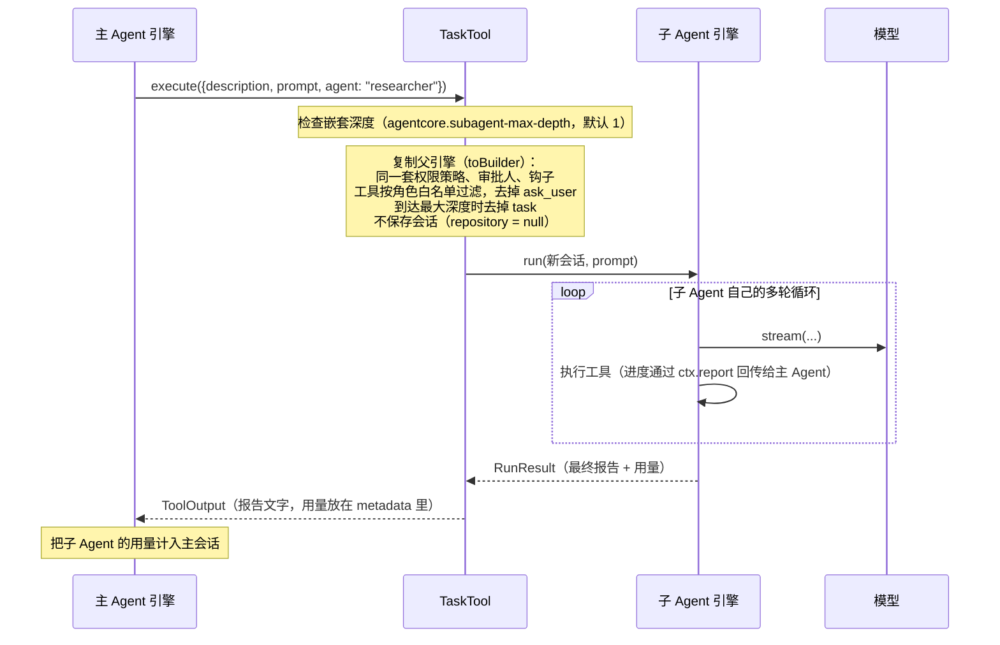

# 04 工具、权限、审批与钩子

模型自己什么都做不了，它只能"说"：请帮我调用某个工具，参数是什么。真正动手的是工具。
因为工具会真的读写文件、执行命令、调用业务接口，**每一次工具调用都要经过一连串检查**，这一篇讲的就是这些检查。

## 1. 一次工具调用经过的关卡

每个调用由 `ToolExecutor` 执行：先查找工具（关卡 1），然后依次经过一条**拦截器链**（`domain/agent/interceptor/`），链的末端才真正执行工具（关卡 7）。任何一关没通过，都不会抛异常中断运行，而是生成一个**错误结果**交还给模型，让它自己调整做法。

| 关卡 | 在哪 |
|---|---|
| 1 工具存在 | `ToolExecutor` |
| 2、3 参数是 JSON、符合 Schema | `ArgumentsInterceptor` |
| 4、5 权限策略、审批 | `PermissionInterceptor` |
| （使用者自己的拦截器） | 插在这里，见本篇第 4 节 |
| 6、9 beforeTool / afterTool 钩子 | `HookInterceptor` |
| 8 截断过长输出 | `TruncateInterceptor` |
| 7 执行（超时、取消） | `ToolExecutor`，链的末端 |



"把错误交还给模型"而不是抛异常，是 Agent 能自我纠正的关键：模型看到 `Error: invalid arguments for edit_file: - old_string is required`，下一轮通常就会改对。

## 2. 权限策略

`PermissionPolicy`（`domain/permission/service/`）对每次调用给出三种结论之一：**允许（ALLOW）/ 拒绝（DENY）/ 询问（ASK）**。它是一个接口，默认实现 `RulePermissionPolicy` 按配置的规则判断，下面讲的判定顺序、模式、规则写法都是这个默认实现的行为；也可以整个换掉，见本节最后。

### 判定顺序



优先级是 **deny > ask > allow > 模式默认值**：只要命中一条 deny，什么 allow 都救不回来。

### 三种模式

| 模式 | 配置写法 | 行为 | 适合 |
|---|---|---|---|
| `default` | `agentcore.permissions.mode: default` | 只读工具直接放行，其他询问 | 有人在旁边看着 |
| `auto` | `auto` / `yolo`，命令行 `--yolo` | 除了 deny 规则，全部放行 | 沙箱、容器、无人值守 |
| `readonly` | `readonly`，命令行 `--readonly` | 只允许只读工具，其他一律拒绝 | 只想让它看看、不许改 |

### 规则写法

写法是 `工具名(匹配模式)`，两部分都支持 `*` 通配符，省略括号表示匹配该工具的所有调用：

```yaml
agentcore:
  permissions:
    allow:
      - "bash(git status*)"        # 允许 git status 开头的命令
      - "bash(mvn test*)"
      - "mcp__filesystem__read*"   # 允许某个 MCP 服务器的所有读工具
    deny:
      - "bash(rm -rf *)"
      - "write_file(/etc/*)"
    ask:
      - "web_fetch"                # web_fetch 虽然只读，也每次都问
```

`bash` 有额外的安全处理，防止用一条 allow 规则偷带危险命令：

- 命令按 `;` `&&` `||` `|` 换行 拆成多个子命令；
- **deny**：任意一个子命令命中就拒绝；
- **allow**：每个子命令都要被某条 allow 覆盖才算放行；
- 命令里有 `$(` `` ` `` `>` `<` 时，allow 规则不生效，转为询问。

所以 `bash(git status*)` 不会放行 `git status && rm -rf /`。

用户在审批时选"总是允许"，`RulePermissionPolicy#remember` 会生成一条尽量具体的规则：bash 记成 `bash(第一个词 *)`，例如 `bash(npm *)`；其他工具记成整个工具名。只在当前进程里有效。

### 换成自己的权限判断

`PermissionPolicy` 接口只有一个必须实现的方法 `check(工具, 参数)`，返回允许 / 询问 / 拒绝和原因；`remember`（用户选"总是允许"时调用）有默认实现：不记住。

```java
PermissionPolicy rules = RulePermissionPolicy.of("default", List.of(), List.of("bash(rm -rf *)"), List.of());
PermissionPolicy tenantPolicy = (tool, args) -> {
    if (!rbac.canUse(CurrentUser.id(), tool.name())) {
        return PermissionPolicy.Verdict.deny("当前用户没有 " + tool.name() + " 的权限");
    }
    return rules.check(tool, args);   // 其余仍按配置规则判断
};
```

Spring Boot 里定义一个 `PermissionPolicy` 类型的 Bean 就会替换掉默认实现；手动组装时传给 `AgentEngine.builder().permissions(...)`。实现要线程安全，并行执行的工具会同时调用它。

**和钩子怎么选**：`PermissionPolicy` 决定"这个工具能不能用、要不要问人"，结果可以是"询问"，会走审批流程；`AgentHook.beforeTool` 在审批之后、执行之前运行，适合按参数做业务拦截或改写参数。

## 3. 审批：谁来回答"可以吗"

审批是一个端口 `Approver`，只有一个方法 `approve(request) → Approval`，可以阻塞到用户做出决定。

| 实现 | 位置 | 怎么问 |
|---|---|---|
| `ConsoleApprover` | `interfaces/cli` | 命令行提示 `[y]允许 / [a]总是允许 / [n]拒绝`，也可以直接输入拒绝理由，理由会交给模型 |
| `AsyncApprover` | `application/approval` | 通过"通道"把请求推给前端（SSE、WebSocket、IM 卡片），等前端回调 `resolve()`，超时就拒绝 |
| 不配置 | | 所有 ASK 一律当成 DENY（无人值守时最安全的默认值） |

`AsyncApprover` 在 Web 场景下的时序：



多个工具同时需要审批时，引擎用一把锁让它们**排队**，一次只弹一个，避免多个提示交错。

## 4. 钩子：不改引擎代码，插入自己的规则

`AgentHook` 有四个方法，都有默认实现，按需覆盖：

| 方法 | 时机 | 能做什么 | 典型用途 |
|---|---|---|---|
| `beforeModel(request)` | 每次调模型前 | 返回修改后的请求 | 注入实时上下文、按租户换参数 |
| `afterModel(response)` | 每次模型回复后 | 只读观察 | 记录用量、审计 |
| `beforeTool(call, tool, args, ctx)` | 权限通过后、执行前 | 放行 / 拦截（原因交给模型）/ 改写参数 | 业务风控、参数补全 |
| `afterTool(call, output, ctx)` | 执行后 | 返回修改后的输出 | 脱敏、追加提示 |

示例（`agentcore-spring-boot-sample/.../RefundLimitHook.java`）：单笔退款超过 100 元转人工。

```java
@Component
public class RefundLimitHook implements AgentHook {
    @Override
    public HookDecision beforeTool(ToolCall call, Tool tool, Map<String, Object> args, ToolContext ctx) {
        if (call.name().equals("refund") && args.get("amount") instanceof Number n && n.doubleValue() > 100) {
            return HookDecision.block("单笔退款超过 100 元需要人工客服处理，请告知用户已转人工");
        }
        return HookDecision.proceed();
    }
}
```

模型会收到 `Blocked by policy hook: 单笔退款超过 100 元……`，然后自然地告诉用户已转人工。

### 拦截器：更底层的扩展点

钩子是给业务方的简单接口；需要包住整个执行过程（计时、追踪、限流、沙箱检查）时，实现 `ToolInterceptor`：

```java
ToolInterceptor sandbox = (inv, chain) -> {
    if (inv.arguments().get("path") instanceof String p && p.startsWith("/etc/")) {
        return ToolOutput.error("Blocked by sandbox: outside workspace");   // 拦下：错误交给模型
    }
    long t0 = System.nanoTime();
    ToolOutput out = chain.proceed(inv);                                    // 放行，执行后面的链
    metrics.record(inv.tool().name(), System.nanoTime() - t0);              // 执行后加工
    return out;
};
AgentEngine.builder()....interceptor(sandbox)    // Spring Boot 里定义 ToolInterceptor 类型的 Bean 即可
```

使用者的拦截器排在参数校验、权限审批之后，所以看到的都是参数合法、已经批准的调用。子 Agent 复制父引擎时会带上它们。

**权限和钩子的分工**：权限规则是通用的、可配置的"能不能用这个工具"；钩子是写在代码里的业务规则，能看到解析后的参数，判断更细。

## 5. 定义工具的四种方式

所有工具最后都是领域接口 `Tool`（`domain/tool/model/Tool.java`）的实现：



**方式一：`@AgentTool` 注解（推荐写业务工具）**。参数的 Schema 从 Java 类型推断，枚举会变成 `enum`，record 会变成嵌套对象：

```java
@AgentTool(description = "查询订单状态、金额和物流单号", readOnly = true)
public Order getOrder(@Param("订单号，例如 A1001") String orderId) { ... }
```

在 Spring Boot 里，Bean 上有这种方法就会被自动注册；不用 Spring 时调用 `AnnotatedTools.from(对象)`。

**方式二：`FunctionTool.builder`**（内置工具都这样写）：

```java
Tool lookup = FunctionTool.builder("lookup")
        .description("按 key 查值")
        .readOnly(true)
        .schema(Schemas.object().string("key", "要查的 key", true).build())
        .handler((args, ctx) -> ToolOutput.text("value-of-" + args.get("key")))
        .build();
```

**方式三：直接实现 `Tool` 接口**，需要完全控制时用，比如 `TaskTool`。

**方式四：MCP 服务器**。在配置里写 `agentcore.mcp-servers`，启动时连接、列出远端工具，每个包装成一个 `McpTool`。远端标了 `readOnlyHint` 的会被当成只读工具。

### 写工具时要注意

| 属性 | 默认值 | 影响 |
|---|---|---|
| `readOnly` | false | 决定默认免审批、能否与其他只读工具并行 |
| `timeout` | 10 分钟 | 超时会中断执行线程。自己控制超时的工具（如 `bash`）返回 null |
| `maxOutputChars` | 30000 | 超出后截掉中间部分，防止撑爆上下文 |
| 抛 `ToolException` | | 表示"模型可以自己修正的错误"，消息会原样交给模型 |
| `ToolContext` | | 拿工作目录、上报进度（`report`）、会话级共享状态（`state`）、取消信号、宿主注入的服务 |

### 内置工具

| 工具 | 只读 | 作用 |
|---|---|---|
| `read_file` | ✓ | 读文件（带行号，支持分段） |
| `glob` / `grep` | ✓ | 按文件名 / 内容搜索 |
| `web_fetch` | ✓ | 抓网页 |
| `write_file` / `edit_file` | | 写文件 / 精确替换 |
| `bash` | | 执行命令，自带超时（默认 120 秒，最长 600 秒） |
| `todo_write` | 免审批 | 维护任务清单 |
| `ask_user` | 免审批 | 向用户提问（需要宿主提供 `UserPrompter`） |
| `memory_save` / `memory_read` / `memory_search` / `memory_delete` | 读、搜只读；写、删免审批 | 长期记忆 |
| `load_skill` | ✓ | 加载一个技能的完整说明 |
| `task` | 免审批 | 派出子 Agent |

## 6. 子 Agent（`task` 工具）

主 Agent 遇到"需要大量搜索、阅读"的子任务，可以调用 `task`，把它交给一个**有独立上下文**的子 Agent。子 Agent 的中间过程不会进入主 Agent 的上下文，主 Agent 只拿到最后的报告。



几个要点：

- 模型在一次回复里发起多个 `task`，它们是可并行工具，会**同时运行**。
- 子 Agent 无法绕过权限：它的每个工具调用照样经过上面的全部关卡。
- 每个角色可以配置自己的提示词、工具白名单、模型（比如用更便宜的模型做搜索）：

```yaml
agentcore:
  subagents:
    researcher:
      description: 只读调研：搜索代码/网页并给出结论
      tools: [read_file, glob, grep, web_fetch]
      model: deepseek:deepseek-flash
```
