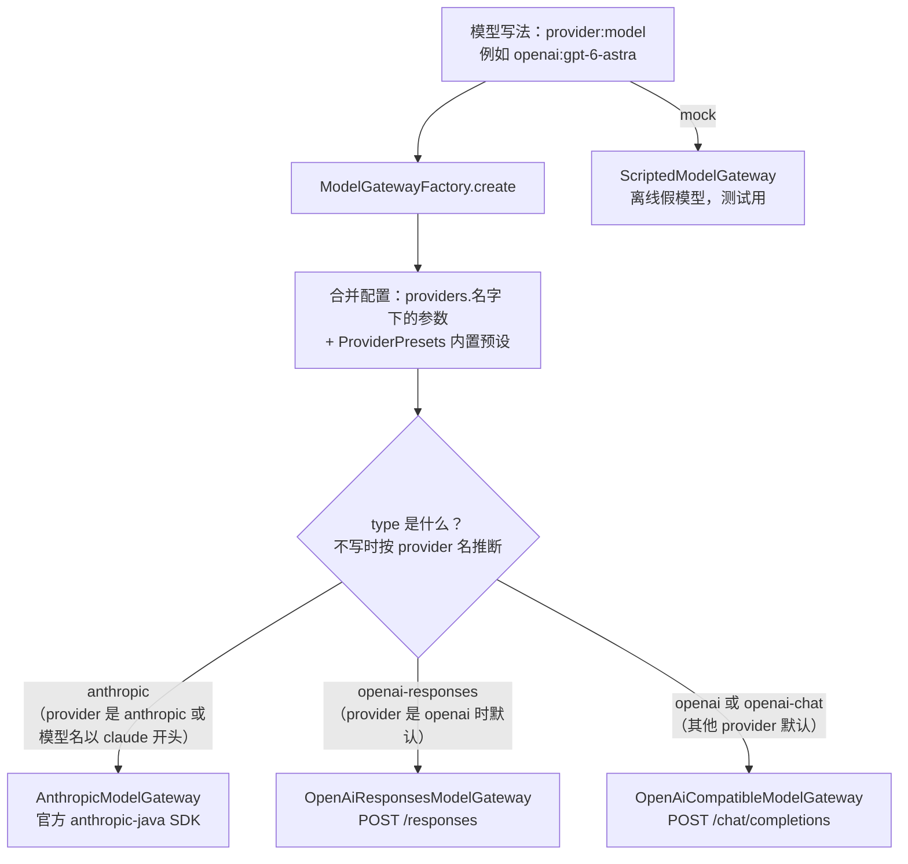
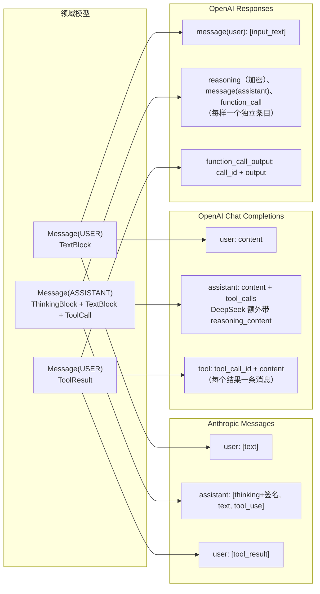
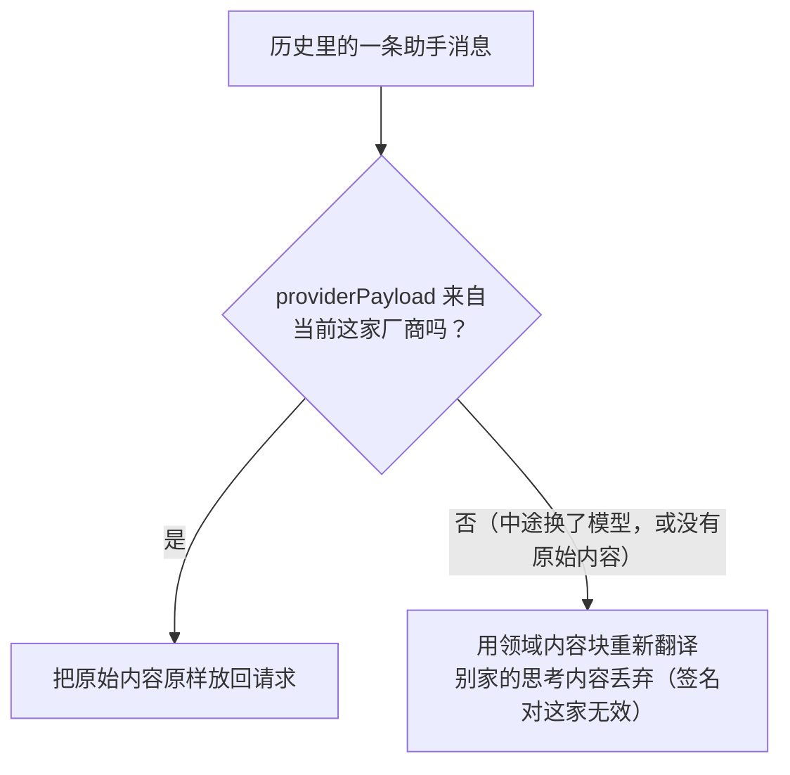
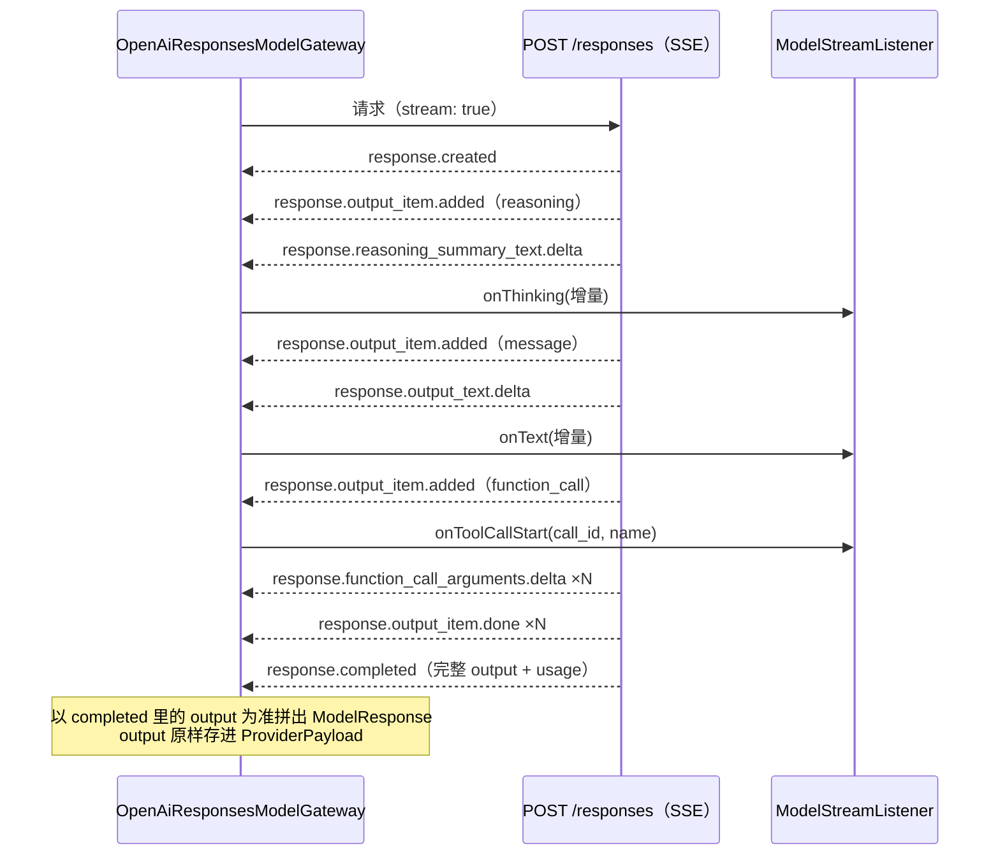

# 05 模型适配

领域层只认识一个接口 `ModelGateway`，不知道 Claude、OpenAI、DeepSeek 的存在。
每家厂商的协议差异都关在基础设施层的适配器里（`agentcore-infrastructure/.../llm/`）。

## 1. 端口：`ModelGateway`

```java
public interface ModelGateway extends AutoCloseable {
    String provider();
    String model();
    int contextWindow();                       // 上下文窗口，压缩阈值按它算
    ModelResponse stream(ModelRequest request, // 系统提示词 + 历史消息 + 工具列表 + 可选参数
                         ModelStreamListener listener,  // 增量回调：onText / onThinking / onToolCallStart
                         CancellationToken cancel);     // 取消时适配器要尽快停止
}
```

适配器要做三件事：

1. **把领域消息翻译成厂商的请求格式**，发出流式请求；
2. **边收边回调**增量，最后拼出一个完整的 `ModelResponse`（消息、停止原因、用量）；
3. **把厂商的错误翻译成三类异常**，引擎据此决定重试、压缩还是放弃：

| 异常 | 含义 | 引擎的反应 |
|---|---|---|
| `ModelException`，`retryable() = true` | 限流、5xx、网络断开、流卡住或没结束就断开 | 指数退避重试（两次之间最多 60 秒）；服务端给了 `Retry-After`（`ModelException#retryAfter`）就按它等，最多 300 秒 |
| `ModelException`，`retryable() = false` | 参数错误、鉴权失败等 | 运行以 ERROR 结束 |
| `ContextOverflowException` | 输入超过上下文窗口（只认明确的说法，例如 `maximum context length`、`prompt is too long`；单个 "too long" 不算） | 压缩后重做本轮 |
| `MalformedOutputException` | 模型输出没法解析 | 直接重发本轮 |

## 2. 三个适配器



| 适配器 | 协议 | 适用 | 实现方式 |
|---|---|---|---|
| `AnthropicModelGateway` | Anthropic Messages API（beta 命名空间） | Claude | 官方 `anthropic-java` SDK |
| `OpenAiResponsesModelGateway` | OpenAI Responses API | OpenAI 新模型、支持 Responses 的代理 | JDK `HttpClient` + 手写 SSE 解析 |
| `OpenAiCompatibleModelGateway` | OpenAI Chat Completions | DeepSeek、通义千问、Kimi、智谱、OpenRouter、vLLM、Ollama…… | JDK `HttpClient` + 手写 SSE 解析 |

OpenAI 系列为什么不用官方 SDK：各家"兼容"服务都有自己的扩展字段（DeepSeek 的 `reasoning_content`、`prompt_cache_hit_tokens`，Responses 回放条目里的 `phase` 等），请求和响应都要按 JSON 处理才不会丢字段，SDK 能替我们做的只剩连接和读流这一小块（也就是 `OpenAiHttp`，约 160 行）。而官方 `openai-java` 的核心 jar 有 70 多 MB（包含 OpenAI 全部接口的类型），换上后可执行 jar 会从约 75 MB 涨到约 150 MB，不划算。

内置预设（`ProviderPresets`）：`openai`、`deepseek`、`qwen`/`dashscope`、`moonshot`/`kimi`、`zhipu`/`glm`、`openrouter`、`ollama`、`vllm`。预设里有默认地址、API Key 的环境变量名、上下文窗口。

## 3. 消息格式怎么互转

领域里的一段对话，到了三家协议里长得完全不一样。下面是同一段"调用工具"的对话在各协议里的样子：



对照表：

| 领域 | Anthropic | Chat Completions | Responses |
|---|---|---|---|
| 系统提示词 | `system` 参数 | 第一条 `role: system` | `instructions` 参数 |
| `TextBlock` | `text` 块 | `content` 字符串 | `input_text` / `output_text` |
| `ImageBlock` | `image` 块（base64 或 url） | `image_url` 部件 | `input_image` |
| `ThinkingBlock` | `thinking` 块（必须带签名回放） | DeepSeek 等的 `reasoning_content` | `reasoning` 条目（摘要 + 加密内容） |
| `ToolCall` | `tool_use` 块 | `tool_calls[]` | `function_call` 条目 |
| `ToolResult` | `tool_result` 块，放在用户消息最前面 | `role: tool` 的独立消息 | `function_call_output` 条目 |
| 工具结果里的图片 | 直接放进 `tool_result` | tool 消息只支持文本，图片挪到随后的用户消息 | `output` 写成数组，直接带图 |
| 工具定义 | `tools[{name, description, input_schema}]` | `tools[{type: function, function: {...}}]` | `tools[{type: function, name, ...}]`（扁平） |

翻译代码分别在 `AnthropicWire`、`OpenAiWire`、`OpenAiResponsesWire`，都是纯函数，测试很方便。

## 4. 原样回放：`ProviderPayload`

每个适配器在返回助手消息时，除了翻译成领域内容块，还把**厂商返回的原始内容**存进 `Message.providerPayload`。下次请求时：



为什么要原样回放：

- **Claude**：思考块带有签名，必须一字不差地带回去，否则请求报错；服务端拒答回退产生的 `fallback` 标记也要保留。
- **OpenAI Responses**：推理内容是加密的（`encrypted_content`），助手消息带有 `phase`（commentary / final_answer），丢了会影响模型表现。原样回放后，默认 `store: false` 也能让模型接上之前的推理，不需要 OpenAI 服务端保存会话。
- **提示缓存**：发出去的内容与上次完全一致，前缀缓存才能命中。

`ProviderPayload` 和消息一起存进会话仓储，重启后照样能回放。中途换模型也没问题：别家的原始内容不会被发出去，只用通用内容块。

## 5. 流式解析

三个适配器都是流式请求，边收边回调，最后拼出完整消息。以 Responses 为例：



各协议的关键差异：

| | Anthropic | Chat Completions | Responses |
|---|---|---|---|
| 读流 | SDK 迭代事件 | `OpenAiHttp.readEvents`（两个 OpenAI 网关共用） | 同左 |
| 拼完整消息 | SDK 的 `BetaMessageAccumulator` | 内部类 `StreamedReply` 按 `index` 累加 `tool_calls` 增量 | 内部类 `StreamedResponse` 取 `response.completed` 里的 `output` |
| 停止原因 | `stop_reason` | `finish_reason` | `status` + `incomplete_details.reason` |
| 结束标志 | `message_stop` | `data: [DONE]` 或 `finish_reason`；两者都没有就断开 → 可重试错误 | `response.completed` / `response.incomplete`；没有就断开 → 可重试错误 |
| 流中报错 | SDK 抛异常 | `error` 字段 | `response.failed` / `error` 事件 |
| 缓存用量 | `cache_read_input_tokens` / `cache_creation_input_tokens` | `prompt_tokens_details.cached_tokens`，DeepSeek 用 `prompt_cache_hit_tokens` | `input_tokens_details.cached_tokens` / `cache_write_tokens` |

**用量统一口径**：领域里的 `TokenUsage.inputTokens` 是**没命中缓存**的输入，缓存命中、缓存写入分开记。OpenAI 两种协议的 `input_tokens` 包含缓存部分，适配器会减掉。

**流卡住**：JDK `HttpClient` 的请求超时只管到响应头到达为止，流开始之后不再生效。所以 `OpenAiHttp.readEvents` 另有一个空闲看门狗：超过 `timeout-seconds`（默认 10 分钟）没收到任何数据就关掉连接，按可重试的错误处理。Anthropic 网关由 SDK 自己的读超时负责。

**重试时界面要丢弃半截回复**：失败前可能已经流出一部分文字，重试会从头重新生成这一轮。引擎会发 `retrying` 事件（输出无法解析时是一条 warning 通知），前端收到后应丢弃这条回复已经显示的部分；保存进历史的始终是成功那次的完整回复。

**工具调用 ID**：结果按 ID 回填，所以 ID 不能为空、不能重复。有的兼容服务会给空 ID 或重复 ID，Chat Completions 网关遇到时换成新生成的 ID（这种协议的历史由我们自己回放，换掉不会和服务端对不上）；其他网关如果给出这样的回复，重试装饰器按"输出无法解析"处理，重发本轮。

**工具参数解析失败**：模型偶尔会输出坏的 JSON。适配器不抛异常，而是生成一个带 `parseError` 的 `ToolCall`，引擎回给模型一个错误结果，模型下一轮会重写。

**取消**：适配器在 `CancellationToken` 上注册回调，取消时直接关闭 HTTP 输入流，阻塞中的读取立刻返回。

## 6. 各适配器的默认参数

下面的参数都写在 `agentcore.providers.<名字>` 下，例如 `agentcore.providers.anthropic.effort: high`。

### Claude（`AnthropicModelGateway`）

| 参数 | 默认值 | 说明 |
|---|---|---|
| `max-tokens` | 64000 | 单次输出上限 |
| `context-window` | 新模型 100 万，旧模型 20 万 | 压缩阈值按它算 |
| `thinking` | 新模型开启自适应思考（adaptive，显示摘要） | |
| `effort` | 新模型 `high` | low / medium / high / xhigh / max |
| 提示缓存 | 开启 | 系统提示词打显式断点，对话尾部自动缓存 |
| `fallbacks` | 直连官方 API 且模型支持时开启 | 服务端拒答回退 |
| `eager-input-streaming` | 直连官方 API 时开启 | 工具参数边生成边流式返回 |

配置了自定义 `base-url`（走代理）时，`fallbacks` 和 `eager-input-streaming` 默认关闭，因为代理不一定支持。

### OpenAI Responses（`OpenAiResponsesModelGateway`）

| 参数 | 默认值 | 说明 |
|---|---|---|
| `max-tokens` | 32000 | 对应 `max_output_tokens`，推理也算输出，所以给得多 |
| `store` | false | 不让 OpenAI 保存；同时请求 `reasoning.encrypted_content` 以便回放 |
| `reasoning-effort` | 不传（用模型默认） | 单次请求的 `effort` 选项可以覆盖 |
| `reasoning-summary` | 不传 | 设成 `auto` 能看到思考摘要（部分组织需先完成验证） |

### Chat Completions（`OpenAiCompatibleModelGateway`）

| 参数 | 默认值 | 说明 |
|---|---|---|
| `max-tokens` | 16000 | 参数名可用 `max-tokens-param` 改，有的服务要 `max_completion_tokens` |
| `echo-reasoning` | 除 `openai` 预设外开启 | 回传历史 `reasoning_content`。DeepSeek 思考模式 + 工具调用时必须 |
| `stream-usage` | 开启 | 请求 `stream_options.include_usage`，流的最后一块带用量 |

所有适配器都支持 `extra-body`（原样并入请求体）、`headers`、`timeout-seconds`（OpenAI 两个网关里同时是"流多久没数据就断开重试"的上限）。

## 7. 接一个新厂商

1. 在 `infrastructure/llm/<厂商>/` 下实现 `ModelGateway`，参照 `OpenAiResponsesModelGateway`（最新、最完整）。
2. 写一个 `<厂商>Wire` 做消息翻译，记得处理"来自别家的历史"。
3. 返回助手消息时，把原始内容放进 `ProviderPayload`，`provider` 用一个唯一的名字。
4. 在 `ModelGatewayFactory.create` 里加一个 `type` 分支。
5. 照着 `OpenAiResponsesGatewayTest`，用 `FakeSseServer` 写测试：一次完整的工具循环、截断、拒答、出错。
