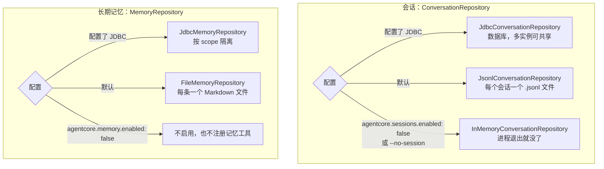
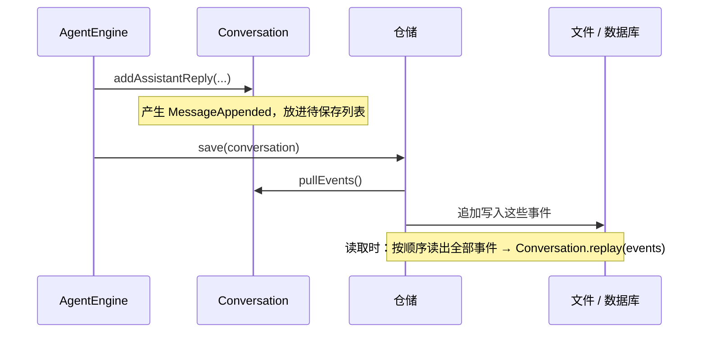
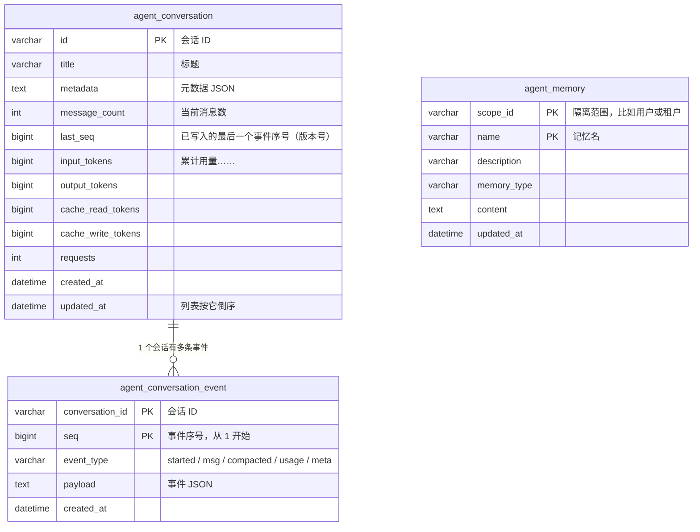
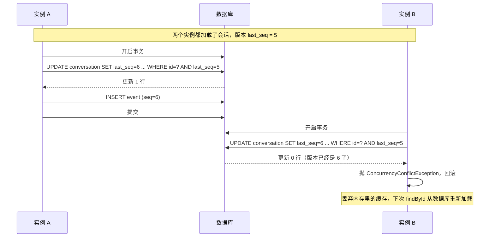
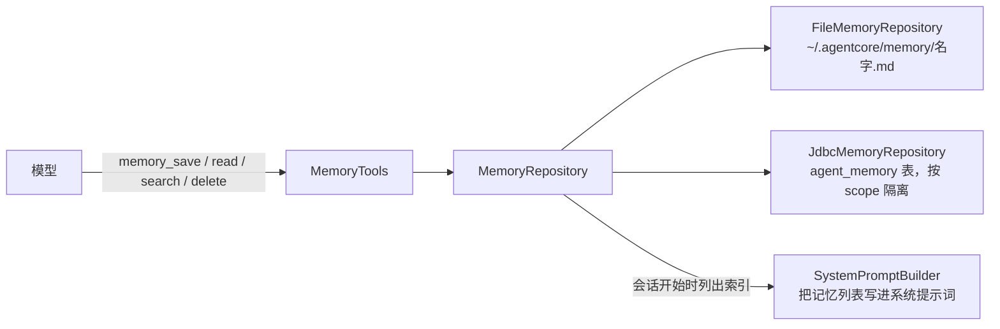

# 06 存储

需要长期保存的东西有两类：**会话**（对话历史）和**长期记忆**（跨会话的事实、偏好）。
领域层只定义了端口 `ConversationRepository` 和 `MemoryRepository`，具体存在哪由基础设施层决定。

## 1. 有哪些实现，怎么选



| 场景 | 推荐 |
|---|---|
| 本机命令行使用 | 默认的文件存储，开箱即用，文件可以直接看 |
| 单机服务，不想装数据库 | SQLite：`spring.datasource.url: jdbc:sqlite:/data/agent.db` + `agentcore.persistence.jdbc.enabled: true` |
| 多实例部署 | MySQL / PostgreSQL 等，所有实例共享历史（但要按会话 ID 做粘性路由，见第 4 节） |
| 测试 | 内存 |

## 2. 共同的原理：只追加事件

不管存在哪，存的都是 `Conversation` 产生的**领域事件**（见 [03 会话聚合](03-conversation.md#3-事件溯源变化即事件事件即存储)）：



仓储不需要理解会话的结构，所以每个实现都很短。事件转 JSON 的代码统一在 `infrastructure/json/DomainCodec.java`。

**身份映射（identity map）**：仓储把加载过的会话缓存起来，同一进程里同一个会话 ID 永远拿到同一个对象。这样 HTTP 接口读详情和正在运行的 Agent 看到的是同一份数据，不会互相覆盖。

## 3. JSONL 文件

默认目录 `~/.agentcore/sessions/`，每个会话一个文件 `<会话ID>.jsonl`，一行一个事件。真实样子：

```json
{"ts":"2026-11-05T02:00:28.835Z","t":"started","id":"20261105-020028-6dab60","metadata":{"agent":"agentcore","cwd":"/xp/www/dsh/data/agent/agentcore-java","model":"mock:scripted"}}
{"ts":"2026-11-05T02:00:28.900Z","t":"msg","m":{"role":"user","content":[{"type":"text","text":"你好"}]}}
{"ts":"2026-11-05T02:00:28.927Z","t":"msg","m":{"role":"assistant","content":[{"type":"text","text":"(mock) 你好，我是一个离线假模型。"}]},"usage":{"input_tokens":2137,"output_tokens":17,"cache_read_tokens":0,"cache_write_tokens":0,"requests":1}}
```

| `t` 的值 | 对应事件 |
|---|---|
| `started` | `ConversationStarted` |
| `msg` | `MessageAppended`（`m` 是消息，助手消息带 `usage`，有原始内容时带 `provider_raw`） |
| `compacted` | `ConversationCompacted` |
| `usage` | `UsageRecorded` |
| `meta` | `MetadataUpdated` |

- 只用追加模式写文件。进程崩溃最多留下半行，读取时跳过这一行并记一条警告。
- 命令行的 `/sessions`、`/resume <id>`、`-c`（继续上一个会话）都基于这个目录。

## 4. 数据库（JDBC）

代码在 `infrastructure/persistence/jdbc/`，只用标准 JDBC，不依赖 JPA 或任何 ORM，目的是**能接尽量多的数据库**。

### 支持的数据库

| 平台 | 建表脚本 | 也适用于 |
|---|---|---|
| MySQL | `schema-mysql.sql` | MariaDB、TiDB、OceanBase（MySQL 模式） |
| PostgreSQL | `schema-postgresql.sql` | 人大金仓、openGauss / GaussDB、CockroachDB |
| Oracle | `schema-oracle.sql` | 达梦 |
| SQL Server | `schema-sqlserver.sql` | |
| SQLite | `schema-sqlite.sql` | 单机、嵌入式（已用真实数据库文件测过） |
| H2 | `schema-h2.sql` | 测试 |

平台默认从 JDBC 连接的元数据自动识别（`JdbcPlatform.detect`），也可以用 `platform` 配置强制指定。
除 SQLite 外，其他平台目前只在 H2 的兼容模式下测过，上生产前建议用真实数据库跑一遍测试。

### 三张表



- `agent_conversation_event` 是真正的数据：事件按 `seq` 顺序存放，读会话就是 `ORDER BY seq` 读出来重放。
- `agent_conversation` 是一张**摘要表**，存标题、用量、更新时间，让"会话列表"不用重放事件就能查出来；它的 `last_seq` 同时充当版本号。
- 表名前缀默认 `agent_`，可以用 `agentcore.persistence.jdbc.table-prefix` 改。
- 大文本字段按平台选类型：MySQL `LONGTEXT`、PostgreSQL `TEXT`、Oracle `CLOB`、SQL Server `NVARCHAR(MAX)`。

### 防止两个实例同时写坏一个会话（乐观并发）

多实例部署时，可能有两个进程同时往同一个会话追加事件。`JdbcConversationRepository#save` 用版本号防止这种情况：



即使两边的 UPDATE 都"成功"了（比如某些隔离级别下），`(conversation_id, seq)` 是主键，第二个 `INSERT seq=6` 也会违反唯一约束，同样被翻译成 `ConcurrencyConflictException`。

`findById` 每次都先查一下数据库里的 `last_seq`：和缓存的版本一样就直接用缓存，不一样（别的实例写过）就重新加载。

**多实例部署的限制**：数据库只共享"历史"。正在运行的任务、等待中的审批、SSE 连接都在某一个进程的内存里，所以负载均衡要**按会话 ID 粘性路由**，同一个会话的请求总是打到同一个实例。

### 启用方式

嵌入 Spring Boot 应用和独立部署版写法完全一样：用 Spring 的 `spring.datasource` 配数据源（连接池是 Spring Boot 默认的 HikariCP），再显式打开开关。

```yaml
spring:
  datasource:
    url: jdbc:mysql://db:3306/app
    username: app
    password: ${DB_PASSWORD}
agentcore:
  persistence:
    jdbc:
      enabled: true                       # 默认 false，显式打开
      table-prefix: agent_
      initialize-schema: create-if-missing  # 或 never（表由 DBA 建）
      memory-scope: default
```

独立部署版的 jar 不带 JDBC 驱动，用环境变量 `AGENTCORE_CLASSPATH` 加到 classpath 上（多个用冒号分隔，整个目录写成 `/opt/drivers/*`）：

```bash
AGENTCORE_CLASSPATH=/opt/drivers/sqlite-jdbc.jar bin/agentcore \
    --spring.datasource.url=jdbc:sqlite:/data/agent.db --agentcore.persistence.jdbc.enabled=true
```

没配置 `spring.datasource.url` 时，独立部署版会跳过数据源的自动装配，照常用文件存储。

`create-if-missing` 会逐张表检查，只创建缺少的表，已有的表不动。

## 5. 长期记忆

记忆是 Agent 跨会话记住的东西：用户偏好、项目背景、之前的结论。模型通过 `memory_save` / `memory_read` / `memory_search` / `memory_delete` 四个工具自己管理。



- 每条记忆（`MemoryEntry`）有名字（唯一键）、一句话描述、类型（user / feedback / project / reference / note）、正文、更新日期。
- 会话开始时，所有记忆的**名字和描述**写进系统提示词，模型需要时再用 `memory_read` 读正文，这样不会一次占用太多上下文。
- 文件版每条一个 Markdown 文件（带 frontmatter），人可以直接打开改、放进 Git。
- 数据库版用 `scope_id` 隔离，比如每个用户一个 scope。

## 6. 技能（Skills）

技能是"教 Agent 做某类事"的说明书，只读，放在文件里：`<目录>/<技能名>/SKILL.md`，frontmatter 写 `name` 和 `description`，与 Anthropic Agent Skills 的约定一致。

- 默认扫描 `.agentcore/skills` 和 `~/.agentcore/skills`，先出现的同名技能优先。
- 系统提示词里只列出技能的名字和描述；模型判断需要时调用 `load_skill` 读取完整说明。
