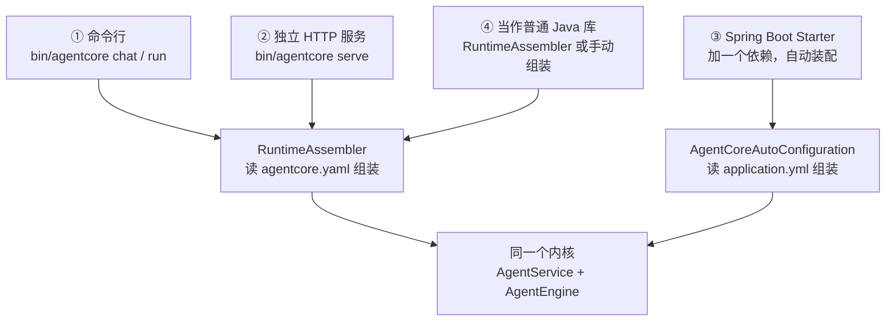
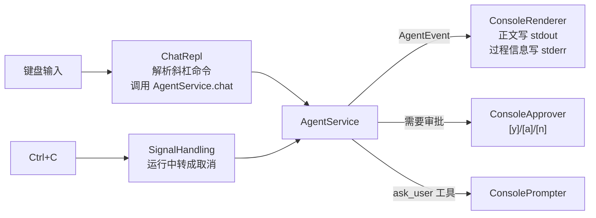
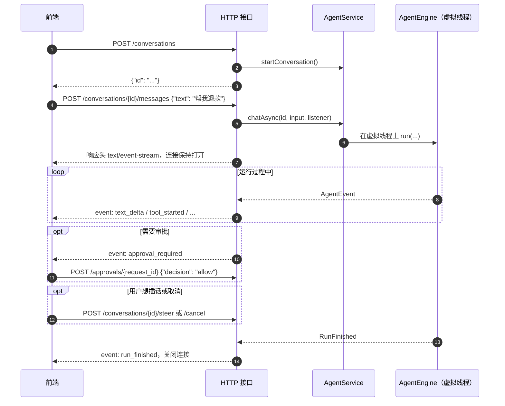

# 07 接入与扩展

同一个内核有四种用法，区别只在"谁来组装、谁来对接用户"。



| 用法 | 适合 | 入口代码 |
|---|---|---|
| 命令行 | 自己在终端里用、调试 | `bootstrap/AgentCoreApplication.java` → `interfaces/cli/ChatRepl.java` |
| 独立 HTTP 服务 | 给前端或别的语言的服务调用，不想引入 Spring | `interfaces/http/AgentHttpServer.java` |
| Spring Boot | 已有 Spring Boot 4 应用，要加一个智能客服、运维助手 | `spring-boot-starter/AgentCoreAutoConfiguration.java` |
| Java 库 | 任意 Java 21 程序，完全自己控制 | `bootstrap/RuntimeAssembler.java`，或直接 `AgentEngine.builder()` |

## 1. 命令行

```bash
bin/agentcore                                    # 交互模式
bin/agentcore run "总结一下 README.md"            # 跑一次就退出
bin/agentcore run --events "..."                 # 每个事件输出一行 JSON，方便脚本处理
bin/agentcore -c                                 # 继续上一个会话
bin/agentcore sessions                           # 列出历史会话
bin/agentcore init                               # 生成带注释的 agentcore.yaml
```

常用选项：`-m <provider:model>`、`--yolo`（全部放行）、`--readonly`、`--no-session`、`--cwd <目录>`。
交互模式里：`/help /new /compact /tools /usage /sessions /resume <id> /memory /exit`，运行中按 `Ctrl+C` 取消当前任务（不会退出程序）。

命令行内部怎么分工：



正文和过程信息分开输出，所以 `bin/agentcore run "..." > answer.txt` 只会得到答案本身。

## 2. HTTP / SSE 接口

独立部署版用 `bin/agentcore serve --port 8080` 启动，路径以 `/api` 开头；Spring Boot 版路径前缀默认 `/api/agent`（`agentcore.web.base-path`）。两者接口一致，完整列表见项目 README 的"HTTP / SSE 接口"一节。

一次完整的交互：



用 curl 试：

```bash
ID=$(curl -s -X POST localhost:8080/api/conversations | jq -r .id)
curl -N -X POST localhost:8080/api/conversations/$ID/messages -d '{"text":"你好"}'
```

输出的每个事件长这样：

```text
event: text_delta
data: {"type":"text_delta","text":"你好"}

event: run_finished
data: {"type":"run_finished","stop_reason":"end_turn","text":"你好！有什么可以帮你？","turns":1,"usage":{...}}
```

几点要注意：

- 发消息的请求会**一直挂着**直到运行结束，前端要按流式读取（`fetch` + `ReadableStream`，或 `EventSource` 的 POST 封装）。
- 前端中途断开连接，服务端写事件失败，会自动取消这次运行。
- 经过 Nginx 时，服务端已经带了 `X-Accel-Buffering: no`，事件不会被缓冲。
- 配置了 `server.token` 后，所有 `/api` 请求都要带 `Authorization: Bearer <token>`。

## 3. Spring Boot

加依赖（版本号以项目实际为准）：

```xml
<dependency>
    <groupId>com.agentcore</groupId>
    <artifactId>agentcore-spring-boot-starter</artifactId>
    <version>${agentcore.version}</version>
</dependency>
```

最小配置：

```yaml
agentcore:
  model: deepseek:deepseek-v4-pro
  providers:
    deepseek:
      api-key-env: DEEPSEEK_API_KEY
  agent:
    instructions: 你是电商平台的客服助手……
  tools: [todo_write]        # 只开放需要的内置工具；@AgentTool 业务工具始终可用
```

然后：

- 任意 Bean 里写 `@AgentTool` 方法，启动时自动注册为工具（`AgentToolRegistrar`）；实现了 `Tool` 接口的 Bean 也一样。
- 实现 `AgentHook` 的 Bean 自动加入钩子链，按 `@Order` 排序。
- 想替换默认组件，定义同类型的 Bean 即可，比如自己的 `ConversationRepository`、`Approver`、`ModelGateway`。
- 注入 `AgentService` 就能在自己的 Controller、定时任务、消息监听里调用 Agent。

完整例子是 `agentcore-spring-boot-sample` 模块：一个电商客服，`OrderTools` 提供查订单、退款两个工具，`RefundLimitHook` 拦截大额退款，`refund` 不是只读工具，所以前端会收到审批请求。

## 4. 当作 Java 库

**读配置一键组装**：

```java
Settings settings = Settings.load(null, Path.of("."));
try (AgentRuntime rt = RuntimeAssembler.assemble(settings, RuntimeAssembler.Options.of(Path.of("."))
        .withApprover(req -> Approval.allow())
        .withExtraTools(AnnotatedTools.from(new OrderTools()))
        .withHooks(List.of(myHook)))) {
    String id = rt.service().startConversation(Map.of()).id().value();
    rt.service().chat(id, "帮我查一下订单 A1001", event -> {
        if (event instanceof AgentEvent.TextDelta t) System.out.print(t.text());
    });
}
```

`AgentRuntime` 要关闭（`try-with-resources`），它会停掉 MCP 子进程、HTTP 客户端等资源。

**完全手动组装**（不读任何配置，每个零件自己选）：

```java
ConversationRepository repository = new InMemoryConversationRepository();
AgentEngine engine = AgentEngine.builder()
        .definition(new AgentDefinition("bot", "你是一个助手", EngineSettings.defaults(cwd)))
        .model(new ModelGatewayFactory(Map.of()).create("deepseek:deepseek-v4-pro"))
        .tools(new ToolRegistry(BuiltinTools.select(List.of("read_file", "grep"))))
        .permissions(PermissionPolicy.of("readonly", null, null, null))
        .repository(repository)
        .build();
AgentService service = new AgentService(engine, repository);
```

可运行的完整例子：`agentcore-bootstrap/src/test/java/com/agentcore/bootstrap/EmbeddingExample.java`，离线可跑，也是测试的一部分。

## 5. 常见扩展怎么做

| 想做的事 | 做法 | 参考 |
|---|---|---|
| 加一个业务工具 | 写 `@AgentTool` 方法；或 `FunctionTool.builder` | [04 §5](04-tools-and-permissions.md#5-定义工具的四种方式)、`OrderTools.java` |
| 加一条业务规则（拦截、改参数、脱敏） | 实现 `AgentHook` | [04 §4](04-tools-and-permissions.md#4-钩子不改引擎代码插入自己的规则)、`RefundLimitHook.java` |
| 接入公司的审批系统 / IM | 实现 `Approver`；或用 `AsyncApprover` 接一个通道 | [04 §3](04-tools-and-permissions.md#3-审批谁来回答可以吗) |
| 接一个新模型厂商 | 实现 `ModelGateway`，在 `ModelGatewayFactory` 里加 `type` | [05 §7](05-model-gateways.md#7-接一个新厂商) |
| 会话存到别的存储（Redis、Mongo…） | 实现 `ConversationRepository`：追加事件、按顺序读出重放 | [06 §2](06-persistence.md#2-共同的原理只追加事件)、`JsonlConversationRepository.java` |
| 接外部工具服务 | 配 `mcp_servers`，不用写代码 | README 的配置一节 |
| 改系统提示词 | `agent.system_prompt` / `agent.system_prompt_file` 整体替换；`agent.instructions` 追加；项目根目录放 `AGENTS.md` 自动并入 | `SystemPromptBuilder.java` |
| 让 Agent 会一类新任务 | 写一个技能：`.agentcore/skills/<名字>/SKILL.md` | [06 §6](06-persistence.md#6-技能skills) |
| 拆分任务给子 Agent | 在 `subagents` 里定义角色（提示词、工具白名单、模型） | [04 §6](04-tools-and-permissions.md#6-子-agenttask-工具) |
| 前端展示运行过程 | 订阅 SSE 事件，按 `type` 渲染 | [02 §8](02-agent-loop.md#8-对外发出的事件) |

## 6. 测试怎么写

不需要任何 API Key：

| 想测什么 | 用什么 |
|---|---|
| 引擎逻辑（工具循环、权限、取消……） | `ScriptedModelGateway`：按脚本返回预先写好的回复，见 `AgentEngineTest` |
| 模型适配器的协议解析 | `FakeSseServer`：本地起一个假的 HTTP 服务，按顺序返回写好的 SSE 帧，并记录收到的请求，见 `ModelGatewayTest`、`OpenAiResponsesGatewayTest` |
| 存储 | `InMemoryConversationRepository`；数据库用 SQLite 临时文件或 H2，见 `JdbcRepositoryTest` |
| Spring 装配 | `ApplicationContextRunner`，见 `AgentCoreAutoConfigurationTest` |

```bash
mvn test        # 全部测试
mvn -pl agentcore-domain test -Dtest=AgentEngineTest   # 只跑一个
```
